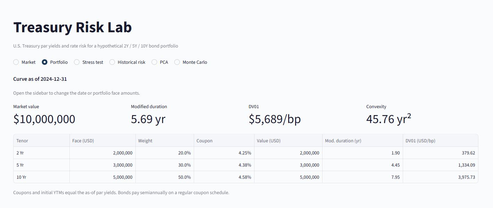
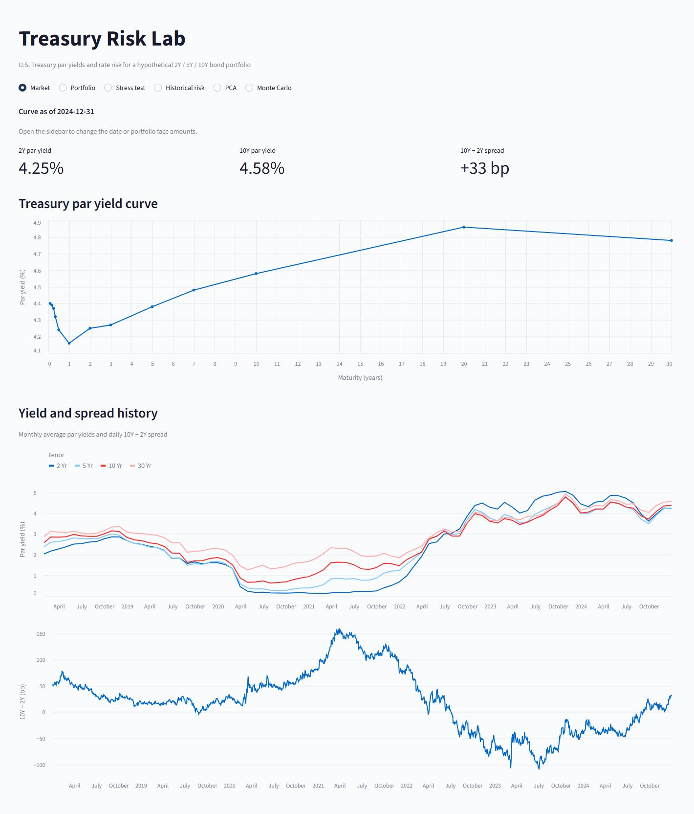
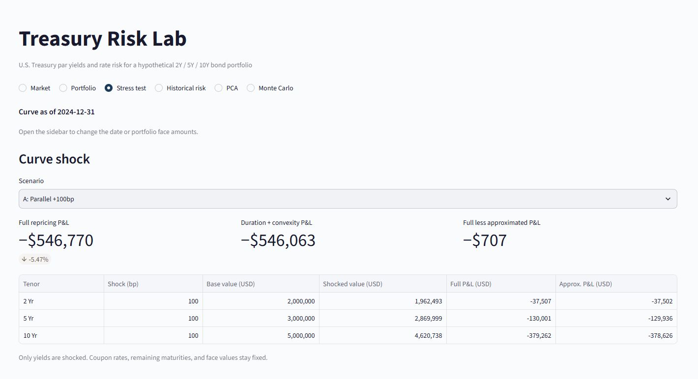
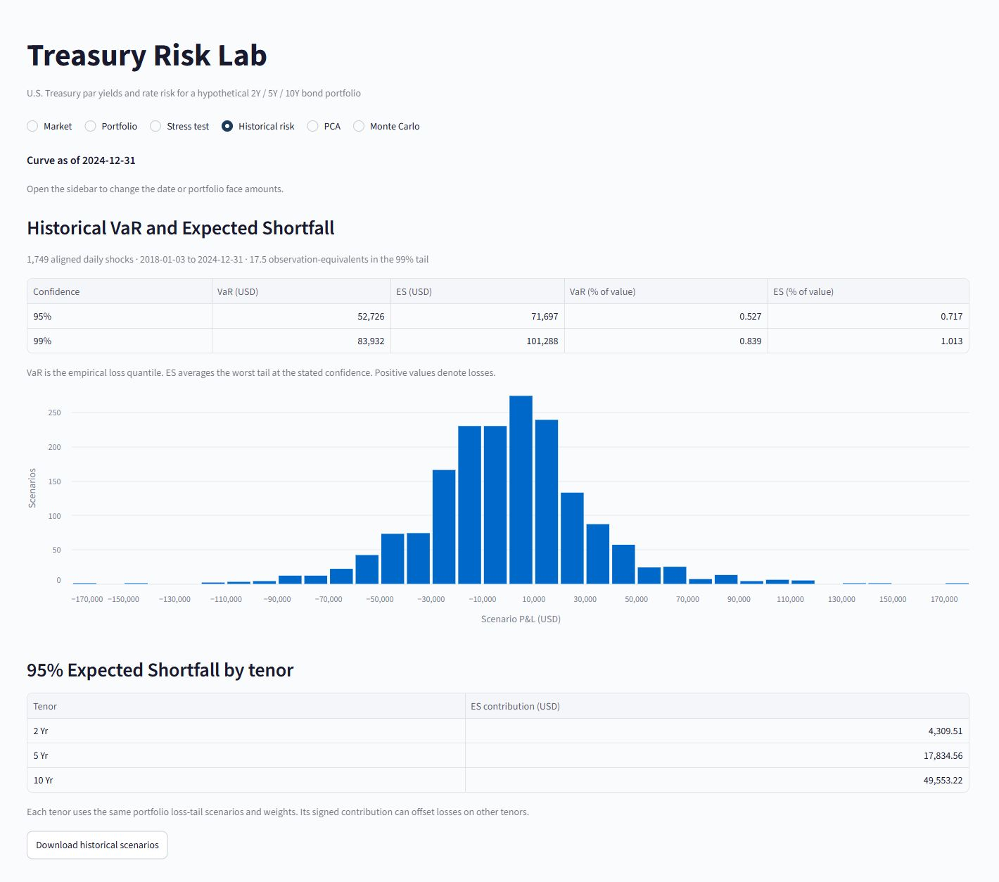
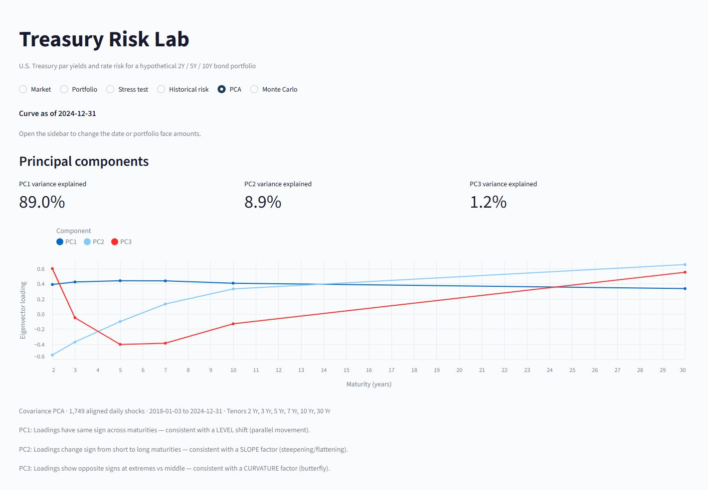
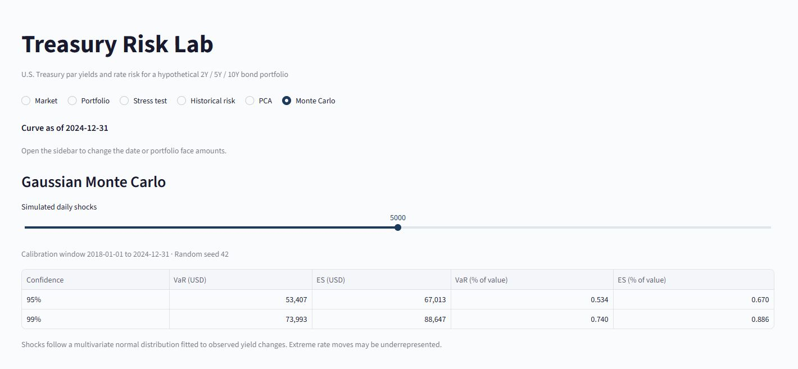

# Treasury Risk Lab

**Fixed-Income Portfolio Risk & Interest Rate Analytics**

**How much can a bond portfolio lose when interest rates change, and which exposures contribute most to that risk?**

Treasury Risk Lab investigates that question using historical U.S. Treasury
par yields and an illustrative **$10 million** portfolio of 2-, 5-, and 10-year
coupon bonds. It connects day-to-day exposure monitoring with stress testing
and historical downside estimates, so a reviewer can compare the loss under a
specified shock with the risks observed across a range of scenarios.

[**🚀 Launch Live Treasury Risk Dashboard**](https://treasury-risk-lab-cz4gdchv4lvhxfa3j8upgr.streamlit.app/)

## Why this project?

A bond portfolio can lose market value when yields rise even if its securities
carry little credit risk. As rates change, each maturity responds differently,
and a change in the shape of the yield curve can matter as much as a parallel
move. Financial institutions need to know where that sensitivity sits, how
much a specified shock could cost, and what historical downside estimates
can support given the available data.

Treasury Risk Lab brings those questions into one workflow. It links observed
curves to a fixed hypothetical portfolio, compares full repricing with a
sensitivity-based estimate, and shows how much each tenor contributes to
the portfolio's historical Expected Shortfall.

## What the reference portfolio shows

As of **December 31, 2024**, the portfolio holds **$2 million in 2Y**,
**$3 million in 5Y**, and **$5 million in 10Y** face value. The synthetic
bonds start at par in this model.

- **Modified duration of 5.6894 years** describes first-order price sensitivity
  to a small parallel yield move. **DV01 of $5,689.44 per basis point** translates
  that sensitivity into approximate dollars. Locally, a parallel 1 bp increase
  would lower modeled value by about $5,689.
- **95% historical VaR of $52,726** and **99% VaR of $83,932** are loss quantiles
  from 1,749 aligned historical yield shocks. Losses can exceed either threshold.
- **95% historical Expected Shortfall of $71,697** and **99% Expected Shortfall
  of $101,288** estimate the average loss in the worst 5% and 1% of the modeled
  scenarios, respectively. The 99% estimate draws on only 17.49 scenario-equivalents.



## Analytical approach

1. **Ingest U.S. Treasury par yields.** Validate the bundled observations and
   align maturities by date to establish which rate moves can enter the analysis.
2. **Analyze curves and spreads.** Compare yields across maturities and track
   the 10Y–2Y spread to see how the curve's shape has changed.
3. **Construct the hypothetical portfolio.** Use 2Y, 5Y, and 10Y semiannual
   coupon bonds to isolate the effect of maturity and position size in a common
   valuation snapshot.
4. **Measure price sensitivity.** Use bond prices, duration, convexity, and
   DV01 to estimate which positions move most when yields change and how
   that sensitivity changes as the move grows.
5. **Stress the curve.** Fully reprice the portfolio under parallel, steepening,
   flattening, or custom shocks. Compare the result with the duration-plus-convexity
   approximation to see when sensitivity estimates diverge from repricing.
6. **Estimate historical downside risk.** Use historical yield moves to estimate
   portfolio VaR and Expected Shortfall. Apply the same portfolio tail weights
   to each tenor so its signed 95% ES contribution reconciles to total portfolio ES.
7. **Examine principal components.** Use loadings and explained variance to
   assess whether yield changes broadly resemble shifts in level, slope, or curvature.
8. **Simulate correlated shocks.** Use a Gaussian Monte Carlo model to estimate
   downside risk under a fitted joint distribution of yield changes and compare
   that perspective with historical scenarios.

## Model limits

This educational research tool uses hypothetical bonds and Treasury par yields
as simplified YTMs. It holds cash flows and remaining maturities fixed through
each shock and omits accrued interest, carry, roll-down, and a bootstrapped
spot curve. Historical estimates depend on the selected window and available
tenors. Gaussian simulations can underrepresent extremes. Out-of-sample
backtesting remains future work. These estimates are intended for research
and education. Production risk management and trading require further validation
and controls. [Data, formulas, and model assumptions](docs/methodology.md)

## Dashboard showcase

The screenshots show the live app with the December 31, 2024 reference
configuration. Portfolio Analytics is shown above.

<details>
<summary>Market Overview</summary>



</details>

<details>
<summary>Stress Testing</summary>



</details>

<details>
<summary>Historical Risk</summary>



</details>

<details>
<summary>Principal Component Analysis</summary>



</details>

<details>
<summary>Monte Carlo</summary>



</details>

## Run locally

Use Python 3.12. Run these commands in the repository root.

```powershell
python -m venv .venv
.\.venv\Scripts\python.exe -m pip install -r requirements.txt
.\.venv\Scripts\python.exe Project01.py
.\.venv\Scripts\python.exe -m unittest discover -s tests -v
.\.venv\Scripts\python.exe -m streamlit run app.py --server.address 127.0.0.1 --browser.gatherUsageStats false
```

On macOS or Linux, use `.venv/bin/python` for the last four commands. Open
[the local dashboard](http://127.0.0.1:8501). For a first walkthrough, select
**Portfolio**, run the **Stress test** for +100 bp, then inspect **Historical risk**.
Open the sidebar to adjust the valuation date and faces. The historical view
offers a scenario-level CSV export in USD and percent of initial portfolio value.

## Streamlit Community Cloud

- **Repository** `Am2210/treasury-risk-lab`
- **Branch** `main`
- **Main file path** `app.py`
- **Python version** `3.12` under Advanced settings
- **Secrets** leave blank
- **App URL** use the [live dashboard URL](https://treasury-risk-lab-cz4gdchv4lvhxfa3j8upgr.streamlit.app/) for this deployment

Community Cloud installs the packages in `requirements.txt`. The app reads the
bundled Treasury CSV and needs no additional data download or system packages.
To deploy from a private repository, Community Cloud needs access to that repo.
Its GitHub access and the app's viewer settings are managed separately.
See the publication status below before enabling public viewing.
[Community Cloud deployment guide](https://docs.streamlit.io/deploy/streamlit-community-cloud/deploy-your-app/deploy)
[App sharing settings](https://docs.streamlit.io/deploy/streamlit-community-cloud/share-your-app)

## Reproduce and validate

The validation command checks the archive row count, date range, selected par yields
against published reference values, par pricing, and price sensitivity. It exits nonzero when a check fails.
GitHub Actions installs the declared dependencies in clean Python 3.12 environments
on Debian 11 and Windows. The Debian job also checks Streamlit server startup.
The test suite includes independent cash-flow repricing for the reference portfolio,
historical VaR and ES checks, and tests for dashboard interactions.

## Repository map

- `data/` holds the bundled public CSV.
- `data_pipeline.py` reads the archive and builds aligned yield changes.
- `bond_pricing.py` handles pricing, sensitivities, and scenario repricing.
- `historical_var.py`, `monte_carlo.py`, `pca_analysis.py`, and
  `stress_testing.py` implement the risk methods.
- `app.py` is the local Streamlit entry point. It was created as a simplified
  replacement after the original interface was truncated during workbook export.
- `Project01.py` is the command-line validation entry point.
- `tests/` covers independent pricing checks, risk regressions, and dashboard interactions.

## Publication status

Code reuse and publication rights for the reconstructed source require confirmation
before public distribution or assignment of a license. The local project uses the
bundled public data and runs without enterprise services or credentials.
